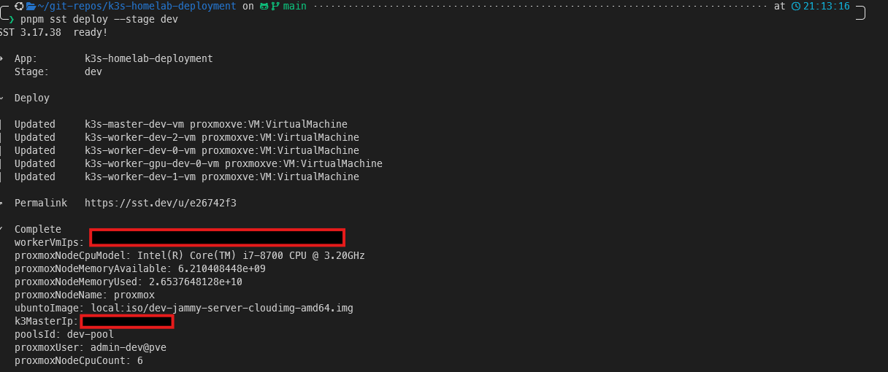
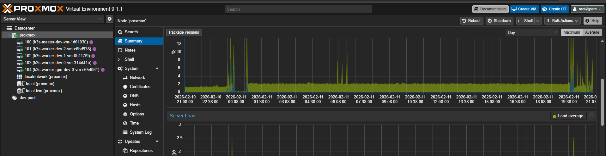
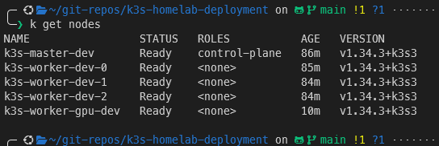

# Homelab setup :)

IaC repo for my homelab usinng Proxmox and K3s. Iac in pulumi/sst

## Deploy Infra

To deploy the infrastructure, run the following command in the root directory of the repo:

Ensure to first configure your .env file. Reference the `template.env`.

Install dependencies. Use `nvm isntall` to download the projects node version and `pnpm` version `10.13.1`.

```bash
pnpm i
```

Deploy stack

```bash
pnpm sst deploy --stage dev
```

To verify, you can login into the UI proxmox as root or you can login with the `admin-dev` (`admin-<stage>`) user created as part of the IaC to scope your view to the specific stage pool on Proxmox.

## Connect to your Cluster

After a successful deploy, configure local `kubectl` with:

```bash
./scripts/setup-kubectl.sh dev
```

That script will:

- install `kubectl` if it is missing
- load kubeconfig from `.sst/outputs.json` (or SSH to the master as a fallback)
- write `~/.kube/config` (with a timestamped backup)
- rename the context to the stage name (default `dev`)
- run `kubectl get nodes`

Optional overrides:

```bash
MASTER_IP=192.168.8.187 SSH_PRIVATE_KEY_PATH=~/.ssh/id_ed25519 ./scripts/setup-kubectl.sh dev
```

## Destroy Infra

To destroy all resources including, VMs, Users, Pools, and Files created by the stack, run:

```bash
pnpm sst remove --stage dev
```

## Screenshots

### SST Deploy



### Proxmox UI - All VM's configured as IaC



### K8s Configured



### Apps

| App                | Address                                                                    |
| ------------------ | -------------------------------------------------------------------------- |
| Grafana            | http://grafana.k3s.local (`GRAFANA_ADMIN_USER` / `GRAFANA_ADMIN_PASSWORD`) |
| Excalidraw         | http://draw.k3s.local                                                      |
| MinIO console      | http://minio.k3s.local                                                     |
| Loki               | http://loki.k3s.local                                                      |
| Tempo (traces UI)  | http://tempo.k3s.local (or Explore → Tempo in Grafana)                     |
| OTLP gRPC / HTTP   | `<any-node-ip>:4317` / `<any-node-ip>:4318`                                |
| MQTT broker (EMQX) | `mqtt://<any-node-ip>:1883` (anonymous allowed)                            |
| MQTT websockets    | `ws://<any-node-ip>:8083`                                                  |
| EMQX dashboard     | http://\<any-node-ip\>:18083 (`admin` / `admin`)                           |

Publish a test MQTT message:

```bash
docker run --rm efrecon/mqtt-client pub -h 192.168.8.187 -t homelab/test -m 'hello'
```

In Grafana: **MQTT & Logs** dashboard, plus **Loki** / **Tempo** datasources (traces ↔ logs linked). Send OTLP traces to `http://<node-ip>:4318`.

Logs: Grafana Alloy (DaemonSet) ships pod logs, k8s events, and host `/var/log` into Loki. In Explore → Loki try `{namespace="mqtt"}` or `{job="syslog"}`.

### Notes

Add local DNS entry so Windows can resolve k3s ingress hostname without port-forwarding

```bash
Add-Content "C:\Windows\System32\drivers\etc\hosts" "`n<Host-Machine-Proxmox-IP> <DNS-Entry-Hosted-On-K3s>"
```

Or on the Beryl router hosts file / dnsmasq: `address=/k3s.local/192.168.8.187`
